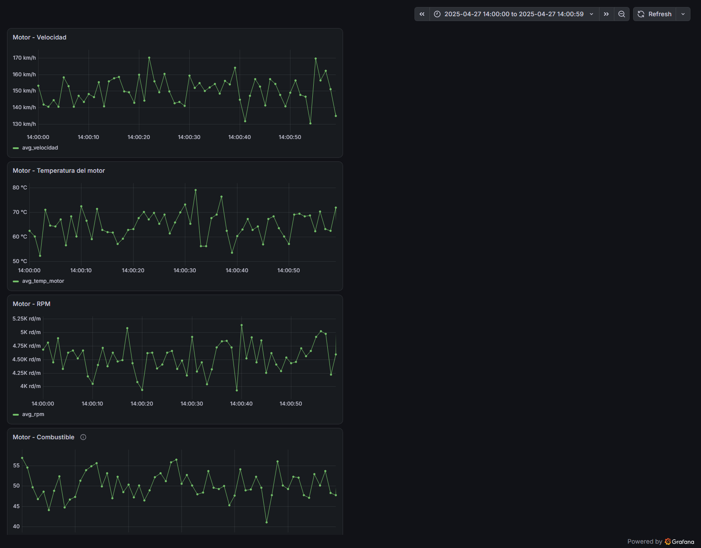

# Motorcycle telemetry dashboard (prototype)

A prototype of the telemetry visualisation stack for the **UPCT motorcycle racing team**. I spent a year and a half on the team, working on the hands-on build and as the person responsible for telemetry. The project defines the set of channels to log from the bike, stores them in SQLite and shows them in **Grafana** dashboards, so the team can analyse engine behaviour after each session.



> ⚠️ **The data in this repository is synthetic.** It is random data generated to design and test the dashboard before real logs from the bike were available, so values such as GPS position jump around unrealistically. It is not real bike telemetry.

## Telemetry channels

32 channels sampled at 100 Hz (every 10 ms):

| Group | Channels |
|---|---|
| Position / IMU | GPS latitude, longitude and altitude; 3-axis accelerometer; 3-axis gyroscope |
| Powertrain | Gear, clutch, RPM, fuel level, speed |
| Chassis | Suspension position; for each wheel: tyre temperature, tyre pressure, angular speed, brake percentage |
| Engine temperatures | Engine, oil, radiator, exhaust |
| Fuel injection | Air flow, fuel flow, throttle opening, air pressure |

## Dashboard

The Grafana *Dashboard Motor* has 7 time-series panels, each an SQL query that averages the 100 Hz samples into 1-second buckets:

- Speed
- Engine temperature
- RPM
- Fuel level
- Temperatures compared: engine, oil, radiator and exhaust
- Injection: air and fuel flow
- Injection: throttle opening and air pressure

## Running it

```bash
cp .env.example .env                        # set a Grafana admin password
pip install -r scripts/requirements.txt
python scripts/csv_to_sqlite.py data/sample_telemetry.csv sqlite_data/telemetry.sqlite
docker compose up -d
```

Then open http://localhost:3000. The SQLite datasource and the dashboard are **provisioned automatically**, in the *Moto* folder.

`data/sample_telemetry.csv` holds 60 seconds of data (6,000 rows). To load a different log, convert any CSV with the same columns to `sqlite_data/telemetry.sqlite`.

## Structure

```
docker-compose.yml                       Grafana + SQLite plugin
grafana/provisioning/                    Datasource and dashboard provisioning
grafana/dashboards/motor.json            "Dashboard Motor" (7 panels)
scripts/csv_to_sqlite.py                 CSV → SQLite loader (pandas)
data/sample_telemetry.csv                Synthetic sample (60 s at 100 Hz)
```

## Author

Javier Muñoz Vera
